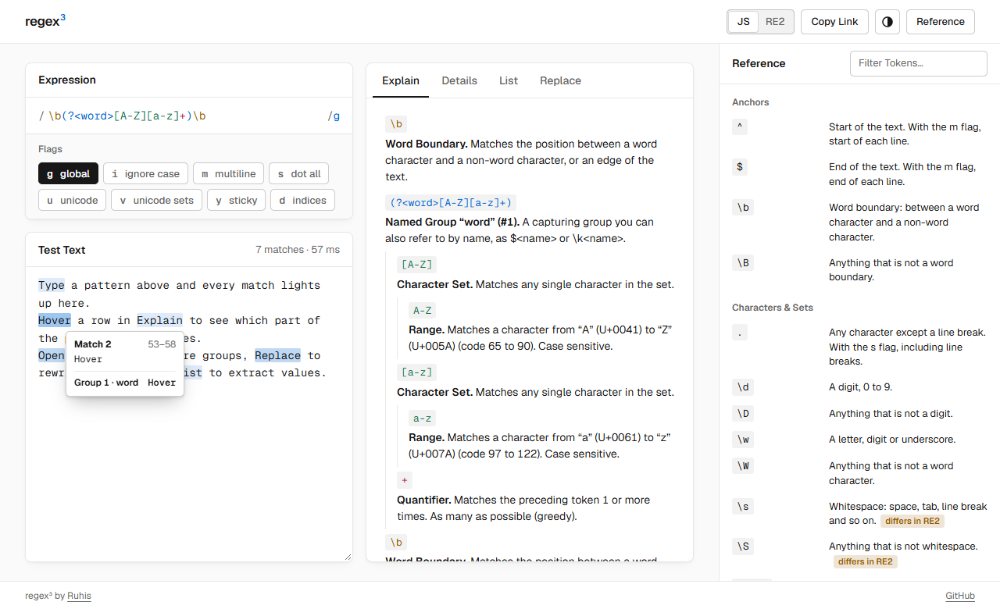

# regex³

[](https://github.com/ruhisfi/regex3/actions/workflows/ci.yml)

<p align="center">
  <picture>
    <source media="(prefers-color-scheme: dark)" srcset="docs/screenshot-dark.png">
    
  </picture>
</p>

Write a regular expression and see what it does. regex³ highlights the matches in your text as you type and explains each part of the pattern in plain English.

## What you can do

- **Test a pattern.** Matches and capture groups are highlighted in the text you paste in. Hover a match to see its position and groups.
- **Understand a pattern.** Explain lists the parts of the pattern one by one (a named group, a quantifier, a character set) with a short description of each. Hover a row to see which characters it covers.
- **Check the results.** Details shows every match with its position and groups. List pulls values out with a template like `$1: $&`. Replace shows the text after a replacement like `$2, $1`.
- **Move patterns to and from code.** Paste a literal like `/\b\w+\b/gi` into the expression and the flags are set for you. Copy the whole expression and you get the literal back, with its slashes and flags. A `/` that would end the literal early is flagged.
- **Look up syntax.** The reference panel is a cheatsheet you can filter. Click a token to insert it into the pattern.
- **Share it.** The pattern, flags and text are kept in the URL, so copying the link shares what you are looking at.

## RE2 mode

Patterns are JavaScript regular expressions by default. Switch to RE2 if the pattern will run somewhere that uses Google's RE2 engine, such as Go's `regexp` package. RE2 supports less than JavaScript: no backreferences, no lookahead or lookbehind, no `\u` escapes. A pattern that works in the browser can be rejected there.

In RE2 mode, regex³ marks those parts in the pattern and lists them under Explain, with a suggested fix where there is one (a `\u` escape is written `\x{…}` in RE2). The matches you see are still produced by the browser's JavaScript engine, so RE2 mode tells you whether RE2 would accept the pattern, not exactly what RE2 would match.

## Running it

Requires Node.js 22.12 or newer.

```sh
npm install
npm run dev
```

`npm test` runs the tests and `npm run build` writes the production build to `dist/`.

With Docker, using the published image (for amd64 and arm64):

```sh
docker run --rm -p 8080:8080 ghcr.io/ruhisfi/regex3
```

Or build it yourself:

```sh
docker build -t regex3 .
docker run --rm -p 8080:8080 regex3
```

Then open http://localhost:8080.

## License

[MIT](LICENSE)

## Attributions

- **Geist** fonts by Vercel, under the SIL Open Font License 1.1. The font files and the license text are in `public/fonts/`.
